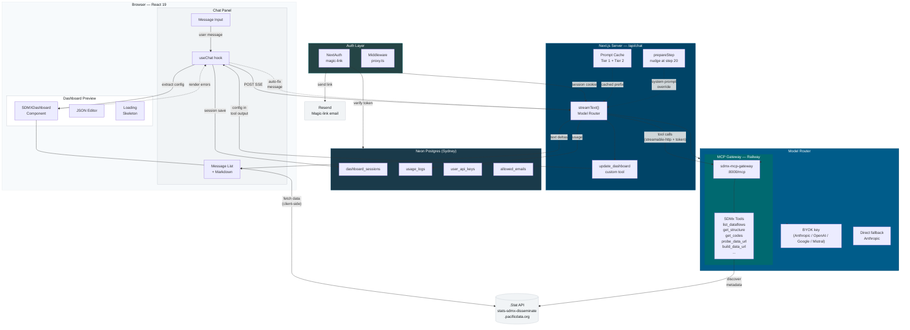

# Data Surfer

A web app where users describe dashboards in natural language and an AI agent produces live SDMx data visualizations for Pacific Island Countries and Territories.

Built on three existing components:
- **sdmx-mcp-gateway** — Python MCP server for progressive SDMx data discovery
- **sdmx-dashboard-components** — React library rendering dashboards from JSON configs via ECharts
- **AI SDK v6** — connects a chat interface to the AI, which orchestrates discovery and produces dashboard configs

Access is limited to approved organisation domains and invited users. Users sign in with Google/Microsoft/GitHub (when configured), email magic links, or a password they set themselves by proving their address with one email they send us (see `docs/email-proof-signup.md`). Sessions and usage are persisted in PostgreSQL.

## Prerequisites

| Tool | Version | Purpose |
|------|---------|---------|
| Node.js | >= 22 | Next.js runtime |
| npm | >= 11 | Package management |
| Python | >= 3.12 | MCP gateway runtime |
| uv | latest | Python package manager (for the gateway) |
| Git | any | Cloning repositories |

You also need:
- A **Google AI API key** ([Google AI Studio](https://aistudio.google.com/)) for the catalogue embeddings (`gemini-embedding-001`)
- A model provider: a **Vercel AI Gateway** key (`AI_GATEWAY_API_KEY` with `USE_AI_GATEWAY=1`, as in production) or an **Anthropic API key** for the direct path
- A **Resend account** with a verified sender domain for magic-link emails
- A **PostgreSQL database**: Neon in deployment; any Postgres URL works locally

## Quick Start

```bash
# 1. Clone and start the MCP gateway
git clone https://github.com/Baffelan/sdmx-mcp-gateway.git
cd sdmx-mcp-gateway
uv sync
uv run python main_server.py --transport streamable-http --host 0.0.0.0 --port 8000

# 2. In another terminal — install and configure the dashboard builder
cd dashboarder
cp .env.example .env.local
# Edit .env.local — set at minimum:
#   DATABASE_URL, NEXTAUTH_SECRET, RESEND_API_KEY, EMAIL_FROM, GOOGLE_AI_API_KEY, ENCRYPTION_SECRET,
#   and either AI_GATEWAY_API_KEY + USE_AI_GATEWAY=1 or ANTHROPIC_API_KEY
npm install

# 3. Apply the database migrations
npx drizzle-kit migrate

# 4. Add yourself as the first admin user
npx tsx scripts/add-pilot-user.ts you@example.com --admin

# 5. Start the dev server
npm run dev

# 6. Open http://localhost:3000 — sign in via magic link, then open /builder
```

### Build the semantic search index (optional but recommended)

The `/explore` page and the agent's catalogue search use a pre-built index. A daily GitHub Action refreshes it; to rebuild locally (requires the MCP gateway and `GOOGLE_AI_API_KEY`):

```bash
npm run build-index
```

This fetches the Pacific Data Hub dataflows, embeds their descriptions with Google's `gemini-embedding-001`, and writes `models/dataflow-index.json`.

## Repository Layout

| Path | What lives there |
|------|------------------|
| `app/` | App Router pages (`/`, `/builder`, `/explore`, `/gallery`, `/dashboard/[id]`, `/p/[id]`, `/settings`, `/admin`, `/about`, `/login`, `/countrysnapshots`) and API routes under `app/api/` (agent loop in `app/api/chat/route.ts`) |
| `components/` | Client UI; PDH chrome in `app-header.tsx`, `app-footer.tsx`, `brand-field.tsx` |
| `lib/` | Server logic: auth, model routing, MCP client and tool policy, dashboard schema/compiler/safety, retention, rate limiting, Drizzle schema (`lib/db/`), coverage, Country Snapshots |
| `drizzle/` | SQL migrations generated by drizzle-kit |
| `models/` | `dataflow-index.json` and `dataflow-coverage.json`, refreshed daily by CI |
| `scripts/` | Index building, imports, user and key maintenance |
| `tests/` | Vitest suites |
| `docs/` | Architecture, technical reference, SPC IT review |

`AGENTS.md` has the detailed map, conventions and patterns.

## Architecture



### Data flow

1. User visits the app — `proxy.ts` middleware checks for a valid NextAuth session; unauthenticated users are redirected to `/login`
2. User requests a magic link; Resend delivers it; NextAuth verifies the token against `allowed_emails` and creates a session
3. User types a message in the chat panel
4. `useChat` POSTs to `/api/chat` with the session ID header; the route verifies the session via NextAuth
5. The model router selects a model: BYOK key first, then platform Gemini 3 Flash, then env fallback
6. `streamText` calls the model with MCP tools + `update_dashboard` custom tool
7. The model does progressive discovery via MCP (`list_dataflows` → `get_dataflow_structure` → `get_dimension_codes` → `build_data_url` → `probe_data_url` → `suggest_nonempty_queries` if empty)
8. `probe_data_url` validates a built URL before the model emits a dashboard, and `suggest_nonempty_queries` recovers empty probes without the model guessing relaxations
9. The model calls `update_dashboard` with an authoring schema config; the server compiles it to native config
10. Tool output flows back to the client via the SSE stream
11. Client extracts config from tool output in message parts
12. `SDMXDashboard` renders the config, fetching live data directly from .Stat
13. If rendering fails, the error is debounced and automatically sent back to the AI
14. Usage (tokens, steps, model) is logged to `usage_logs`; session messages/config are saved to `dashboard_sessions`

## Features

### Authentication and access control
- OAuth (Google, Microsoft, GitHub), email magic-link via Resend, and passwords
- Admission: an `allowed_domains` rule, the `allowed_emails` invite list, or a provider opened in `AUTH_OPEN_SIGNUP_PROVIDERS`
- Self-service password signup/reset proved by an inbound email (DMARC pass + exact From), no mail sent to the user
- All routes protected by NextAuth middleware (`proxy.ts`)
- Admin role for invite and user management

### Multi-model support
- **Platform models:** OpenAI, Anthropic and Google models through Vercel AI Gateway, with zero data retention and no prompt training requested on every call (`lib/platform-models.ts`)
- **BYOK (Bring Your Own Key):** users can add Anthropic, OpenAI, Google or Mistral API keys in `/settings`; keys are encrypted at rest with AES-256-GCM
- Model picker in the builder header to switch provider/model mid-session
- Model router (`lib/model-router.ts`): a readable BYOK key takes priority, then platform models through the gateway, then the direct Anthropic path when the gateway is off

### Conversational dashboard building
- Natural language requests produce live SDMx dashboards
- AI proposes structure for complex requests, builds panel-by-panel
- Multi-turn conversation to refine charts, add panels, change data

### Dashboard authoring schema
- The AI emits simplified intent visuals (`kpi`, `chart`, `map`, `note`) rather than raw native configs
- Server-side compiler (`lib/dashboard-authoring.ts`) translates intent visuals to the native `sdmx-dashboard-components` config format
- Native passthrough (`mode: "native"`) available for advanced cases
- Zod schema validates tool input before compilation

### Probe workflow
- `probe_data_url` MCP tool validates a candidate SDMx data URL before dashboard emission
- Catches empty results, malformed keys, and missing dimensions early in the agent loop
- Reduces the feedback-loop round-trips caused by bad URLs reaching the live preview

### Live preview with JSON editor
- Real-time dashboard rendering via SDMXDashboard component
- Syntax-highlighted JSON editor with inline editing and apply/reset
- Loading skeleton matching the dashboard grid layout

### Session persistence (database-backed)
- Conversation history, dashboard config, and undo stack saved to Postgres per user
- Survives page refresh and works across devices
- Session list on the welcome page; up to 20 sessions per user
- Sessions auto-titled from the first user message

### Undo/redo
- Every dashboard update (AI or manual) pushes to a 50-entry history stack
- Undo/redo buttons in the preview header
- History persisted in the database session record

### Admin dashboard (`/admin`)
- Invite management: add/remove emails from the allowlist
- User list with role badges, session count, and token usage
- Role toggle (user/admin) per user
- Accessible only to users with `role = 'admin'`

### BYOK settings (`/settings`)
- Store one API key per provider (Anthropic, OpenAI, Google)
- Select preferred model per provider
- Keys encrypted server-side before storage; never logged

### Semantic search in `/explore`
- Data catalogue browser listing all SDMx dataflows on Pacific Data Hub
- Short queries use keyword filtering; three or more words trigger semantic search
- Semantic search compares the query's `gemini-embedding-001` embedding (Google) with the pre-built index, so the search phrase is sent to Google
- Country filter shows which dataflows have data for a selected Pacific territory

### Export
| Format | File | Offline | Interactive |
|--------|------|---------|-------------|
| PDF | `.pdf` | Yes | No |
| HTML (static) | `.html` | Yes | No |
| HTML (live) | `-live.html` | No | Yes |
| JSON Config | `.json` | Yes | N/A |

### Error feedback loop
- Per-panel render status and typed error codes from the library (no crashes)
- Uncaught fetch failures still caught via `unhandledrejection` as a safety net
- Errors debounced, deduplicated, and auto-sent to AI as system messages
- AI attempts to fix the dashboard config and re-emit; max 2 auto-retries

### Tier 2 knowledge context
- Conversation history scanned for already-discovered dataflows and URLs
- Compact summary injected into the system prompt each turn
- Prevents redundant MCP discovery calls, saving tokens and steps

### Request logging
- Every chat request is written to the `usage_logs` table in Postgres (session ID, user, tokens, model, duration)
- The `logs/` directory is legacy from the earlier JSONL logger and is no longer the active logging backend

## Environment Variables

Copy `.env.example` to `.env.local` and fill in the values; every variable is commented there. `docs/technical-reference.md` §19 groups them by purpose for production.

## Development

```bash
npm run dev         # Start dev server (Turbopack)
npm run build       # Production build (Webpack)
npm run lint        # ESLint
npm run test        # Vitest suite
npm run build-index # Build semantic search index (requires the MCP gateway)
```

### Tests

Tests use [Vitest](https://vitest.dev/) and live in `tests/` (one file per `lib/` module, plus `tests/country-snapshots/`). CI runs lint, tests and the build on every pull request and push to `main`.

### Auth middleware

`proxy.ts` at the project root is the Auth.js middleware. It protects every route except the public ones listed in its `matcher` (sign-in, about, gallery, published dashboards, public APIs, the SDMx relay, Country Snapshots, training and the cron route).

### Database migrations

```bash
npx drizzle-kit generate # Generate migration SQL from lib/db/schema.ts
npx drizzle-kit migrate  # Apply pending migrations (records them in drizzle.__drizzle_migrations)
npx drizzle-kit studio   # Open Drizzle Studio to browse data
```

Back up production before migrating it; see the release procedure in `docs/technical-reference.md` §19.

The schema is defined in `lib/db/schema.ts`; `docs/current-architecture.md` §5 describes the persistence model.

## Deployment

### Vercel (Next.js app)

Production (`sdmxsurfer.net`) builds from `main`; the development deployment (`sdmx-surfer.vercel.app`) builds from `dev`. Functions run in Sydney (`vercel.json`), next to the Neon database. See `docs/technical-reference.md` §19 for services, environment variables and the release procedure. To create the first admin user:

```bash
npx tsx scripts/add-pilot-user.ts admin@example.com --admin
```

### Railway (MCP gateway)

1. Create a new Railway project and add a service from the `sdmx-mcp-gateway` GitHub repo
2. Set the start command:
   ```
   uv run python main_server.py --transport streamable-http --host 0.0.0.0 --port 8000
   ```
3. Set the `MCP_AUTH_TOKEN` environment variable in Railway (any strong random string)
4. Note the Railway service's public URL; set `MCP_GATEWAY_URL=https://<railway-url>/mcp` in Vercel
5. Set the same `MCP_AUTH_TOKEN` value in Vercel so the Next.js app can authenticate to the gateway

## Design System

The UI follows the **Pacific Data Hub visual identity** (guidelines V1.0, 2025); see `docs/pdh-visual-alignment.md`. Tokens live in `app/globals.css` and are mirrored in `lib/brand-theme.ts`. The earlier "Oceanic Data-Scapes" mockups in `stitch_assets/` are superseded.

## Troubleshooting

### "Unauthorized" on the chat API
The session cookie is missing or expired. Sign out and sign in again via the magic-link flow at `/login`.

### MCP gateway won't start
Ensure Python >= 3.12 and `uv` are installed. Run `uv sync` before starting.

### Magic links not arriving
Check that `RESEND_API_KEY` is set and `EMAIL_FROM` is a verified Resend sender. In development, Resend delivers to real addresses — there is no local preview mode.

### "Error while fetching data please provide valid api url"
The data URL is malformed or returned no data. The error is auto-sent to the AI for fixing. Check that `probe_data_url` is being used before `update_dashboard` — the system prompt instructs the agent to probe first.

### Semantic search returns no results
The index is missing or stale, or `GOOGLE_AI_API_KEY` is not set (queries are embedded at request time). Run `npm run build-index` with the MCP gateway running.

### Dashboard shows "Loading..." forever
Check the browser Network tab — SDMx REST requests to `stats-sdmx-disseminate.pacificdata.org` may be failing (CORS or network).

### Hydration mismatch after code changes
```bash
rm -rf .next && npm run dev
```

### Database connection errors
Ensure `DATABASE_URL` is set and the Neon branch is reachable. Use the direct (non-pooler) connection string for `drizzle-kit migrate` and `pg_dump`.

## Technical Reference

See [`docs/current-architecture.md`](docs/current-architecture.md) for the implemented route/access/publication model, and [`docs/technical-reference.md`](docs/technical-reference.md) for lower-level technical internals and module descriptions.

## License

Copyright 2026 The Pacific Community (SPC). This project is licensed for
**noncommercial use**, with two licenses covering different parts:

- **Source code** (the application and its scripts): PolyForm Noncommercial
  License 1.0.0. See [`LICENSE`](LICENSE).
- **Documentation, specifications, and design assets** (`docs/`, the top-level
  architecture/spec documents, `stitch_assets/`): Creative Commons
  Attribution-NonCommercial 4.0 International (CC BY-NC 4.0). See
  [`LICENSE-DOCS`](LICENSE-DOCS).

Both require attribution to The Pacific Community (SPC) and prohibit commercial
use. Lead developer: Giulio Valentino Dalla Riva (SDD, SPC); copyright is held
by SPC. See [`AUTHORS`](AUTHORS) for credits.

See `dashboard-architecture.md` for project context and phased delivery plan.
