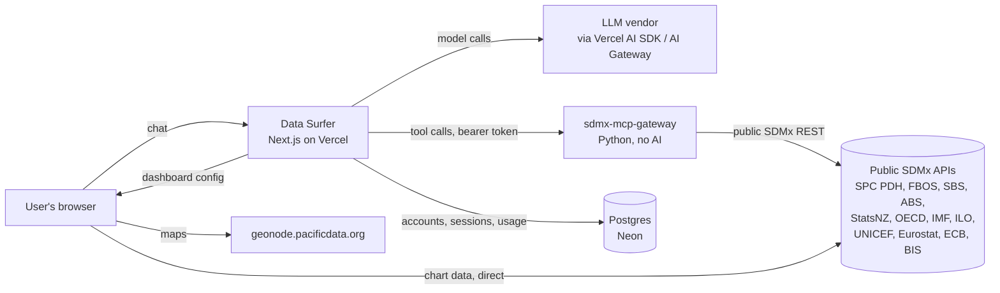

# Data Surfer: Architecture, Web Security and Responsible AI

*A briefing for the SPC IT team. Status as of November 2026.*

## 1. Why this document

Data Surfer is moving from an invite-only alpha towards a service hosted under `pacificdata.org`. Before that happens we want SPC IT to understand how it is built, what it stores, how it uses AI, and where we would value your review.

We have tried to be precise rather than promotional. Each claim points to the file that implements it, so you can check it. Section 9 lists the gaps we know about, with what we plan to do about each. We would rather you hear about them from us.

**In one paragraph:** Data Surfer lets someone describe the dashboard they want ("child mortality in Melanesia since 2000, with a map"). It then builds that dashboard from official SDMx statistics. The work is split three ways:
- **Data discovery** is done by a deterministic, AI-free MCP gateway written in Python.
- **Drawing** is done by SPC's own open-source chart library.
- **A language model** sits between the two. It turns the request into a sequence of discovery calls, then into a dashboard specification.

The model does not supply the numbers in a chart. Every plotted value is fetched by the viewer's browser directly from the statistical agency's public API.

## 2. Architecture at a glance

| Component | What it is | AI? | Where it runs |
|---|---|---|---|
| Data Surfer app | Next.js 16 / React 19 / TypeScript, App Router | Orchestrates one LLM | Vercel (serverless functions) |
| [sdmx-mcp-gateway](https://github.com/Baffelan/sdmx-mcp-gateway) | Python MCP server, declared MIT in its `pyproject.toml`. Its only runtime dependencies are `mcp`, `pydantic`, `httpx` and `certifi`: no model, no AI library | **No** | Railway, behind a bearer token (anyone can run their own copy from the public repo) |
| [sdmx-dashboard-components](https://github.com/PacificCommunity/sdmx-dashboard-components) `1.0.0-rc.2` | SPC's React/ECharts SDMx dashboard library, published on npm, CC-BY-4.0 | **No** | The viewer's browser |
| [sdmx-json-parser](https://github.com/PacificCommunity/sdmx-json-parser) `0.4.2` | SPC's SDMX-JSON parser, on npm, ISC licence | **No** | The viewer's browser |
| Language model | One of several vendors (§4.4) | Yes | Vendor cloud |
| Database | Postgres on Neon, accessed with Drizzle ORM | No | Neon |
| Email | Resend (sign-in links and codes) | No | Resend |

The app's own code belongs to SPC. It is licensed under PolyForm Noncommercial 1.0.0, with documentation under CC BY-NC 4.0 (`LICENSE`, `LICENSE-DOCS`).

### 2.1 Where it is deployed

| Piece | Hosted on | Details |
|---|---|---|
| Source code | GitHub, [`PacificCommunity/sdmx-surfer`](https://github.com/PacificCommunity/sdmx-surfer) (SPC's organisation) | `main` is production. A CI workflow runs lint, tests and the build on every pull request and push. A daily Action rebuilds the dataflow catalogue and coverage index from the public SDMx APIs and commits them; it holds the gateway URL and token and the embedding key as GitHub secrets |
| Web app and API | Vercel (paid plan, which 300-second agent turns and zero-data-retention routing require) | **Production:** `sdmxsurfer.net`, built from `main`. **Development:** `sdmx-surfer.vercel.app`, built from the development branch with its own database branch and a banner pointing to production. TLS, scaling, the daily retention cron, BotID and the AI Gateway account all live in the same Vercel team. Secrets are Vercel environment variables. Server functions run in Sydney (`syd1`, set in `vercel.json`). Static pages and routing are served from the edge nearest the visitor |
| MCP gateway | Railway, Docker image of the public [`Baffelan/sdmx-mcp-gateway`](https://github.com/Baffelan/sdmx-mcp-gateway) repo, in Singapore (`asia-southeast1`) | One HTTPS endpoint (`/mcp`), reachable only with the bearer token the app holds (`MCP_AUTH_TOKEN`). Stateless: it calls the public SDMx APIs and keeps nothing |
| Database | Neon (serverless Postgres), AWS `ap-southeast-2` (Sydney) | Production and development use separate branches. Neon provides encryption at rest and backups. Accessed only from the app's server functions and from maintainer scripts |
| Email | Resend | Sends sign-in links from `surfer@sdmxsurfer.net`. A receiving domain (`in.sdmxsurfer.net`) exists for the email-proof sign-up, which is built but switched off |
| DNS | Hover (registrar for `sdmxsurfer.net`) | Interim domain until `surfer.pacificdata.org` (§8) |
| Map layers | SPC's `geonode.pacificdata.org` | Fetched directly by viewers' browsers |
| Language models | OpenAI, Anthropic and Google, through Vercel AI Gateway | §4.4–4.5 |

**Region.** The servers that run the app and store its data sit in the Asia-Pacific:
- the app's server functions run in Sydney;
- the database is in Sydney;
- the MCP gateway is in Singapore;
- the Pacific Data Hub API answers through a Sydney edge.

Until this release, functions ran in Vercel's default US-East region, so every database query crossed the Pacific twice; we moved them. Two things still leave the region: model calls, which go to the AI vendors (mostly in the US) under the zero-data-retention terms in §4.5, and sign-in emails, which go out through Resend.

## 3. The data: public, open access, and fetched the way anyone would fetch it

Data Surfer has **no privileged access to any dataset**. It reads only the public SDMx REST APIs that statistical agencies publish for everyone. A researcher with `curl` outside SPC can make exactly the same requests. The list of providers is fixed in code (`lib/endpoints-registry.ts`):

| Key | Provider | API host |
|---|---|---|
| SPC | Pacific Data Hub | `stats-sdmx-disseminate.pacificdata.org` |
| FBOS | Fiji Bureau of Statistics | `data-sdmx-disseminate.statsfiji.gov.fj` |
| SBS | Samoa Bureau of Statistics | `data-sdmx-disseminate.sbs.gov.ws` |
| ABS | Australian Bureau of Statistics | `data.api.abs.gov.au` |
| STATSNZ | Stats NZ, Aotearoa Data Explorer | `api.data.stats.govt.nz` |
| OECD, ESTAT, IMF, ILO, UNICEF, ECB, BIS | International agencies | their public SDMx endpoints |

Some details, for completeness:
- **Stats NZ** publishes open data but asks every consumer to register for a free subscription key. We hold one server-side (`SDMX_STATSNZ_KEY`). A small relay, `app/api/sdmx-proxy/route.ts`, attaches it so the key never reaches the browser. The same relay passes through Eurostat and OECD, whose APIs do not send CORS headers. It accepts only those three hosts, each with a path allowlist, and only over https.
- **Map layers** come from SPC's own `geonode.pacificdata.org` (Pacific EEZ boundaries).
- **Country Snapshots** is a sibling feature with curated country profiles. Its indicator list was assembled from SPC's 2026 indicator workbook. Every chart in it still points at public Pacific Data Hub SDMx queries.
- **Catalogue index.** We keep a pre-built index of dataflow titles, structures and availability in `models/dataflow-index.json`, refreshed daily by a GitHub Action. It covers the 127 Pacific Data Hub dataflows, is built from the same public catalogue endpoints, and contains metadata only, no observations.

A Content-Security-Policy on every response generates its `connect-src` from the same provider registry (`lib/content-security-policy.ts`). Even if a dashboard configuration were tampered with, a viewer's browser could not be told to fetch from or send data to anywhere other than these agencies and SPC's map servers. Images and fonts are limited separately, to the basemap tiles (Esri), Google Fonts and a colour-scheme host.

## 4. How AI is used, and how it is kept honest

### 4.1 Design principle: AI as a matchmaker between deterministic parts

We deliberately kept AI out of the parts where correctness matters most. Both ends of the pipeline are conventional, deterministic, testable software that SPC or the SDMx community already trusts:

1. **Finding data** goes through the MCP gateway. It is plain Python that calls the SDMx REST API and summarises structures, codelists and availability. It contains no model, is cheap to run, and anyone can run their own copy.
2. **Drawing data** goes through `sdmx-dashboard-components`. Given a configuration and an SDMx data URL, the library fetches the observations and draws the chart.

The language model's job is to **connect the two**. It reads the user's request, asks the gateway the right questions, chooses dataflows, dimensions and chart types, and writes a dashboard configuration. That configuration contains *SDMx query URLs, chart types, titles and notes*. It does **not** contain the plotted numbers. When the dashboard renders, the viewer's browser fetches each series directly from the agency's API (§2 diagram).

This gives a strong property: **the model has no channel for supplying the numbers that are plotted**. If the model picks the wrong series, the chart shows the right numbers for the wrong series. The panel's provenance link (`components/dataflow-provenance.tsx`) and the SDMx query make that mistake visible and checkable. The one free-form block the model can write, `extraOptions` (chart styling), accepts presentation-only keys, so it cannot add data points or reference lines (§4.3).

### 4.2 What the model can see, and what it cannot

To be precise about the boundary:

- **The model sees public metadata and small samples.** These are dataflow lists, dimension codelists, time availability, and the result of `probe_data_url`. That tool checks a query returns data, and returns the observation count plus a handful of sample observations. All of it is public. The model may quote a figure from a probe in chat, for example "2,480,244 people in 2023, from UNICEF's demography series".
- **The model has no other network access.** It gets 8 of the gateway's 19 tools (`lib/mcp-tool-policy.ts`, `DEFAULT_MODEL_FACING_MCP_TOOLS`). It also gets two app-side tools: `update_dashboard`, and `get_indicator_coverage`, which returns observation *counts* per country and year, never values. Tools that accept a URL refuse anything that is not a registered provider. There is no web browsing, no code execution and no database access.
- **The model never sees personal data beyond the conversation.** User emails, passwords, keys and other users' sessions are never placed in its context.

### 4.3 Guardrails

| Layer | What it does | Where |
|---|---|---|
| Tool allowlist | Only discovery and verification tools are exposed to the model | `lib/mcp-tool-policy.ts` |
| URL guard | Probes and suggestions accept only http(s) URLs on registered providers | `lib/mcp-tool-policy.ts` |
| Intent-level authoring | The model writes a constrained, zod-validated schema, compiled server-side into the library format | `lib/dashboard-authoring.ts`, `lib/dashboard-schema.ts` |
| Reference safety | Data references may only target registered providers and SPC map hosts; markup is stripped from all text | `lib/dashboard-safety.ts` (`sanitizeDashboard`) |
| Presentation-only chart options | The free-form `extraOptions` block passed to ECharts accepts only styling (axis names, stacking, colours, line style…). Anything that could carry figures (`data`, `dataset`, `markLine`/`markPoint`/`markArea`, `graphic`, formatters with digits, images) is dropped, and the model is told what was removed. Applied when the model emits a dashboard, on save, and on every public read | `lib/extra-options.ts`, `lib/dashboard-safety.ts` |
| Panels carry the numbers | The system prompt tells the model not to write figures in prose (chat, titles, notes). It describes what the data shows in words and answers requests for a number with a KPI or table panel, whose value comes straight from the provider. When a figure in text is unavoidable, it must be quoted exactly from a tool result in the conversation, with dataflow and provider named. The model must never answer from memory | `lib/system-prompt.ts` (`LET THE PANELS CARRY THE NUMBERS`, `NOTHING FROM MEMORY`) |
| Step limits | At most 25 tool steps per turn in the builder (12 or 25 in Country Snapshots), with a nudge at 20 | `app/api/chat/route.ts` |
| Usage caps | 20 agent turns per user per rolling 24 h, 5 published dashboards, and a global AI budget cap (default USD 1,000) | `lib/usage-caps.ts` |
| Error hygiene | Provider and model errors are never shown verbatim to users | `app/api/chat/route.ts` |
| Disclosure | Each published dashboard states once, under its title, that its titles and notes were composed with an AI assistant and that every charted figure is fetched directly from the listed providers | `app/p/[id]/page.tsx` |

We developed these rules against real failures. In one case a model answered from memory after an empty probe (commit `9591cd6`). For this review we re-checked both default models with a question answerable from a probe ("What is Fiji's population?"). Claude built a KPI panel and GPT re-checked the data; neither wrote the figure in prose. The rule is an instruction, not a code check (see §9.2).

### 4.4 Vendor independence

The agent loop is written against the **Vercel AI SDK**, an open-source abstraction over model providers. Switching vendor means changing configuration, not code. Today the app supports:

- **Platform models through Vercel AI Gateway** (`USE_AI_GATEWAY=1`), a single router in front of OpenAI, Anthropic and Google models. The catalogue is in `lib/platform-models.ts`. Cost per request is reported by the gateway, which feeds our budget cap. Every gateway request asks for zero data retention and no prompt training (§4.5).
- **A direct Anthropic path** when the gateway is not enabled.
- **Bring-your-own-key (BYOK)** for Anthropic, OpenAI, Google and Mistral. Partner organisations can use their own contracts and data-processing terms.

Choosing a model is a routing decision in `lib/model-router.ts`. Because the deterministic parts carry the factual load, the app degrades gracefully across models: a weaker model makes worse choices of dataflow and chart, but the values it plots still come from the agency.

**Embeddings.** Semantic search over the Pacific Data Hub catalogue uses Google's `gemini-embedding-001` (`lib/embeddings.ts`). Dataflow descriptions are embedded at index-build time. On the `/explore` page the user's search phrase is also embedded, which means it is sent to Google.

### 4.5 What goes to an AI vendor

The model vendor receives:
- the user's chat messages;
- the system prompt;
- the tool results (public SDMx metadata and samples);
- the current dashboard configuration.

It does not receive account data.

**Retention by the vendor.** Every request through AI Gateway sets `zeroDataRetention` and `disallowPromptTraining` (`providerOptionsFor` in `lib/model-router.ts`):
- With ZDR set, the gateway only routes to providers that have a zero-data-retention agreement with it. The gateway itself does not keep prompts or responses.
- We checked all five platform models live with ZDR enforced. All five were served under ZDR: OpenAI for GPT, Anthropic for Claude, and Google Vertex for Gemini, with Google AI Studio skipped because it lacks ZDR.
- A per-model flag in `lib/platform-models.ts` lets a future model without a ZDR provider fall back to no-training only rather than disappear. The data is open statistics, so we preferred availability over dropping the model.
- Keys users bring themselves (BYOK) and the direct-Anthropic fallback run under the key holder's own API terms.

## 5. Web security

### 5.1 Authentication

Built on **Auth.js v5**:
- `lib/auth.ts` holds the Node side. `lib/auth.config.ts` and `proxy.ts` hold the edge-safe side, which gates every page.
- Sessions are signed JWT cookies that expire after 7 days without use. Every 5 minutes the server re-checks the user against the database. A user who has been removed or is no longer admitted is signed out, and a role change takes effect (`lib/session-revalidation.ts`).

| Mechanism | Details |
|---|---|
| Admission | Invite-only. An email must match an admin bootstrap list, an allowed domain, or an allowed address (`lib/admission.ts`, `lib/signup-policy.ts`). The domain list holds partner organisations (e.g. `spc.int`, `mfat.govt.nz`, and the suffix rule `.govt.nz`). Consumer email domains are refused for domain rules. Two wider modes (open sign-up for named OAuth providers; password sign-up for listed domains) exist behind environment flags and are off unless configured |
| OAuth | Google, Microsoft Entra and GitHub, each enabled only when configured. GitHub requires a verified email; Entra checks the email-verified claim |
| Passwords | **Argon2id** (m = 19 MiB, t = 2, p = 1), 12–128 characters, in `lib/password.ts` |
| Brute force | Account locks for 15 min after 5 failures; per-email throttle of 10 failures per 10 min, unknown emails included (`lib/auth-throttle.ts`) |
| Magic links | 15-minute validity, single use. Production refuses to send (rather than log) a link if the email service is not configured |
| Email proof | One-time code over email: 50-bit code, browser secret stored only as SHA-256, 15-minute TTL, 5 starts per hour per address and per IP |
| Bot protection | Vercel BotID on the sign-up and email-proof endpoints (`instrumentation-client.ts`) |
| Training codes | Workshop access codes are throttled: at most 30 failed claims per IP and 200 overall per 15 minutes, recorded as auth events |

### 5.2 Authorisation and data boundaries

- Every private API route checks the session server-side and scopes database queries to the owner's `userId`. Asking for another user's session returns 404, so session ids cannot be probed.
- Administrative routes (`app/api/admin/**`) require `role = "admin"`.
- **Public dashboards** (`/p/[id]`, `/gallery`) use a reduced projection. It contains the title, description, configuration, author display name and publication date. It never includes chat history, edit history, owner email or keys. Public reads re-sanitise every time and are served with `Cache-Control: no-store` (`docs/current-architecture.md` §6).

### 5.3 Browser-side defences

- **Content-Security-Policy** on every response, with `connect-src` limited to this site, the registered SDMx providers and SPC map hosts. `frame-ancestors 'self'` everywhere except published dashboards. SPC sites (`*.pacificdata.org`, `*.spc.int`) may embed those.
- **Other headers:** `Strict-Transport-Security` (2 years), `X-Frame-Options: SAMEORIGIN` (except embeddable published dashboards), `X-Content-Type-Options: nosniff`, `Referrer-Policy: strict-origin-when-cross-origin`, and a `Permissions-Policy` that disables camera, microphone, geolocation, payment, USB and topics (`next.config.ts`).
- **Markup stripping** on every text field of a dashboard. This covers saves, publishing and public reads. The chart library renders some strings as HTML, so this closes a stored-XSS path.
- **CSRF**: every state-changing route checks the `Origin` header against the deployment URL. Credential, sign-up and admin routes use the strict mode, which rejects a missing `Origin` (`lib/csrf.ts`). The only route that creates data from a link (forking a Country Snapshot into the builder) is POST-only.
- **SDMx relay limits:** requests that use our Stats NZ key are limited to 120 per IP in any 10-minute span. A sliding-window counter avoids bursts at window boundaries, and one atomic SQL statement decides each request (`lib/rate-limit.ts`). IPs are stored only as a keyed hash (HMAC-SHA256 with a server secret), so they cannot be recovered by brute force. Every relayed response is capped at 20 MB. On Vercel, `X-Forwarded-For` is set by the platform and cannot be spoofed by clients, so per-IP limits are reliable.
- **No secrets in the client bundle**: there are no `NEXT_PUBLIC_*` secrets. All keys are read server-side from Vercel environment variables.

### 5.4 Dependencies

`SECURITY_AUDIT.md` records the npm audit history. At the last full review it showed zero high-severity advisories. The remaining moderate ones were in build-time or dev-only tooling (drizzle-kit's esbuild, Next's nested postcss) and in the Country Snapshots import script (`exceljs`). We removed `nodemailer` entirely during the Auth.js v5 migration. We would welcome SPC's standard dependency scanning on the repository.

## 6. What we store, and who can see it

We keep the data model small and know what is in every table (`lib/db/schema.ts`). A daily job enforces the retention periods below (`lib/retention.ts`, scheduled in `vercel.json`, authenticated with `CRON_SECRET`). The About page states the same in plain language, in a "What we record" section linked from the sign-in page.

The policy has two parts:
- **Usage records** (counts, tokens, cost) are kept for budget accounting and are never deleted within 12 months.
- **Logs and prompt excerpts** are kept for **3 months**. That gives administrators time to review misuse, after which they are removed.

**Account deletion is self-service** (Settings → Delete account, confirmed by typing the account's email; `lib/account-deletion.ts`):
- **Removed at once:** the user's dashboards, which are unpublished immediately and erased for good after 30 days; their API keys; their OAuth links; any pending sign-in tokens; their password, name and picture.
- **Signed out at once:** the browser that deleted the account, and any other session within 5 minutes.
- **Email address:** released immediately, so the person can register again.
- **Kept for review:** the original address stays visible to administrators, next to the account's usage, for 3 months, then it is erased. The anonymous usage counts remain for the budget.

Deletion cannot be used to hide misuse, because the record of past use outlives the account by the same 3 months that applies to everyone.

**Costs are never deleted.** Usage rows, with their token counts and cost, stay attached to the deleted account's anonymous record. Spending by people who create and delete accounts therefore stays in the global AI budget and in admin spend reports. The same holds when workshop accounts are removed in bulk (`scripts/training-accounts.ts --delete` uses the same deletion path).

Deleting and re-registering also does not reset the per-user daily limit: for the 3-month review window, the limit counts the usage of earlier accounts deleted under the same address (`usageOfPerson` in `lib/usage-caps.ts`).

| Data | Why | Protection | Kept | Who can read it in the app |
|---|---|---|---|---|
| Email, display name, avatar URL | Account identity | Database at rest (Neon) | While the account exists; on deletion the email is kept 3 months for misuse review, name and picture are cleared at once | The user; admins |
| Password hash | Password sign-in | **Argon2id**, never stored or logged in plain text | While the account exists | Nobody |
| BYOK API keys (optional) | User's own model contract | **AES-256-GCM**, random 96-bit IV, 128-bit auth tag; key derived from a server secret that can be rotated (`scripts/rotate-encryption-secret.ts`); never returned to the browser | Until the user removes it | Nobody; decrypted only in memory for the user's own requests |
| OAuth account tokens | Standard Auth.js account linking | Database at rest | While the account exists | Nobody via the app |
| Dashboard sessions | The user's dashboards and their chat transcripts | Owner-scoped queries | Until the user deletes them; deleted ones purged after **30 days** | The owner; public projection only if published |
| Usage logs | Cost control, abuse detection, quality review | Truncated excerpts: prompt ≤ 500 chars, reply ≤ 1,000, tool args ≤ 500, results ≤ 300 | Excerpts removed after **3 months**; token counts and cost kept for budget accounting (never deleted within 12 months) | **Admins only** |
| Auth events | Security audit trail (sign-ins, failures, password sets, account deletions) | Includes email and IP for failed attempts | **3 months** (90 days) | Admins only |
| Rate-limit counters | Relay abuse protection | Keyed HMAC of the IP, no raw IP | About 20 minutes | Nobody |

**On logs specifically:**
- Every route that reads `usage_logs` requires the admin role.
- No route exposes one user's logs, chats or private dashboards to another user.
- The app has **no third-party analytics or trackers**: no Google Analytics, Sentry, PostHog or Vercel Analytics.
- The only cookies are the Auth.js session cookies and one short-lived, httpOnly, path-scoped cookie for email proof.

**Secrets:**
- All service secrets live in Vercel's encrypted environment variables. These are `AUTH_SECRET`, `ENCRYPTION_SECRET`, the model API keys, `MCP_AUTH_TOKEN`, `SDMX_STATSNZ_KEY` and the database URL.
- `.env*.local` files are gitignored, and no secret is committed to the repository.

## 7. Testing and quality

**Automated tests:** 545 Vitest tests in 44 files, all passing (`npm test`, run for this report). A GitHub Actions workflow (`.github/workflows/ci.yml`) runs lint, the tests and the production build on every pull request and every push to `main`. The tests concentrate on the logic where mistakes are costly:
- admission and sign-up policy, login redirects, email proof, CSRF and IP helpers;
- encryption round-trips and tamper detection;
- model routing, BYOK fallback, zero-data-retention options and key rotation;
- the MCP tool policy and URL guard;
- dashboard safety (host allowlist, markup stripping, presentation-only chart options);
- security headers and framing rules, session revalidation, training-code and relay rate limits, and the retention job;
- usage caps and budget accounting;
- dashboard authoring and compilation, message sanitisation, and the Country Snapshots catalogue, import pipeline and fork route.

A module-boundary test keeps the Country Snapshots feature isolated from the core app.

**Environments:** a standing development deployment, with its own URL and an isolated database branch, receives every change before production. The most recent production schema migration was applied after a full database backup.

**Library and gateway acceptance:**
- Before switching to the npm release of `sdmx-dashboard-components` 1.0, we rendered 11 reference dashboards (99 panels) across 11 providers and compared them with the previous build (`docs/sdmx-dashboard-components-1.0-integration.md`).
- The MCP gateway has its own live end-to-end suite: 41 scenarios across 10 providers (`docs/mcp-endpoint-per-call-update.md`).
- Fixes we needed in SPC's chart library were written up and prepared as upstream pull requests (`docs/upstream-prs/`, `docs/sdmx-dashboard-components-improvements.md`), rather than kept as private patches.

**User testing:**
- The invite-only alpha ran with roughly **50 users** across Pacific governments and partner organisations (`docs/prototype-to-production.md`).
- A **training-day mode** gave around **100 workshop participants** their own accounts in minutes, via a shared code and a pool of 200 throwaway accounts that a script parks or deletes afterwards (`docs/training-day.md`, `scripts/training-accounts.ts`).
- Observed sessions, from users and from our own testing, drove much of the product's evolution. The commit history records examples: the provenance and pacing rules in the system prompt, empty-data recovery through `suggest_nonempty_queries`, several-angle dashboards instead of single charts, and Pacific-centred maps (EPSG:3832).
- The usage logs in §6 exist partly for this: they show where the agent struggles, so the prompt and tools can be improved.

**Model evaluation:** prompt changes are checked against the failing case that motivated them and re-run on more than one model. Commit messages record the cases tested.

## 8. Pending with SPC

| Item | Status |
|---|---|
| Registration in SPC authentication (Microsoft Entra / SSO) | **Waiting on SPC IT.** The provider is implemented in code and needs an app registration in SPC's tenant (`docs/oauth-setup.md`). Our attempts to register it were refused (no access), so Microsoft sign-in stays disabled until IT can do it |
| Google sign-in for production | Needs an SPC-owned Google Cloud project in Published status (Testing status caps at 100 users) |
| Email delivery to `spc.int` | **Needs an IT message trace.** Sign-in emails from our sender are accepted by SPC's Exchange Online ("delivered" in Resend) but never reach the mailbox, junk or quarantine. We suspect the hybrid hand-off to on-prem Exchange or a transport rule (`docs/superpowers/plans/2026-11-06-sign-in-and-demo-access.md`). SSO would make this moot for SPC staff |
| Move to `surfer.pacificdata.org` | **Waiting on DNS and registration.** The app currently runs at `sdmxsurfer.net`. The move needs the OAuth redirect URIs for all three providers re-registered, and moving the email sender to the SPC domain would help deliverability |
| Hosting jurisdiction | The app's functions and database run in Sydney and the stateless MCP gateway in Singapore. Model calls go to the AI vendors, and sign-in emails go through Resend. None of this is in a Pacific Island country. We would like SPC's guidance on whether that is acceptable for this class of data (public statistics, plus user emails and chat text) |
| Named owner and on-call | A governance decision for the public beta (`docs/prototype-to-production.md` §7) |

## 9. Known gaps: what we fixed and what remains

Our own review for this document found the gaps below. None of them exposed non-public statistical data, because the app holds none. We fixed most of them straight away, and each fix has tests.

### 9.1 Fixed in this release

| # | Gap | What we changed |
|---|---|---|
| 1 | The Stats NZ relay could be used by scripts that fake the `Origin` header, spending SPC's key quota | Sliding-window per-IP limit on key-bearing requests (120 in any 10 minutes, keyed IP hashes, one atomic statement shared across instances), and a 20 MB response cap on every relayed host. Tested against Postgres for boundary bursts and 300 concurrent requests |
| 2 | No headers beyond CSP | HSTS, `X-Frame-Options`, `frame-ancestors`, `Referrer-Policy`, `Permissions-Policy` and `nosniff` (§5.3). Published dashboards can be embedded by SPC sites only |
| 3 | Country Snapshots routes lacked the CSRF check; forking ran on GET | `checkCsrf` on chat, log, warm and fork; fork is POST-only |
| 4 | Sessions lived 30 days and kept the role from sign-in | 7-day sessions, re-checked against the database every 5 minutes; removed users are signed out |
| 5 | Training-code endpoint had no rate limit | Per-IP and global throttle on failed claims |
| 6 | A misconfigured production deploy could log sign-in links | Production refuses to send the link instead |
| 7 | Usage logs, auth events and deleted dashboards were kept indefinitely; there was no account deletion | Daily retention job (excerpts and auth events 3 months, deleted dashboards 30 days, usage counts kept); self-service account deletion that keeps a 3-month review window (§6) |
| 8 | Users were not told that admins can read prompt excerpts | "What we record" section on the About page, linked from sign-in |
| 9 | No zero-retention or no-training terms with AI vendors | ZDR and no-training on every AI Gateway request; all platform models verified ZDR-eligible |
| 10 | No rotation for the BYOK master secret; unreadable keys fell back silently | `ENCRYPTION_SECRET_PREVIOUS` plus a re-encryption script; unreadable keys are flagged in Settings and logged without key material |
| 11 | `extraOptions` could add chart content that did not come from the API | Restricted to presentation-only keys at every entry point |
| 12 | AI authorship of dashboard text was not disclosed | One statement on each published dashboard (§4.3) |
| 13 | No CI gate | Lint, tests and build on every pull request and push to `main` |
| 14 | Per-IP throttles trusted `X-Forwarded-For` | Verified not exploitable: Vercel overwrites this header with the real client IP |

### 9.2 Still open, and why

1. **Admins can read prompt excerpts** for 3 months. This is intended, for quality review and abuse handling, and is disclosed on the About page. A separate, smaller "reviewer" role could narrow it further.
2. **Admin-set passwords** are a stopgap. They let us give access before a proper sign-in integration existed. They will be removed once SPC SSO is in place.
3. **`'unsafe-inline'` scripts in the CSP.** Next.js needs it for its bootstrap scripts. Markup stripping is our XSS defence. Nonce-based CSP is possible but makes every page dynamic. We will revisit it with the framework.
4. **OAuth email account linking** (`allowDangerousEmailAccountLinking`) lets one person sign in with different providers against the same email. GitHub and Entra are checked for verified email. We will review it as part of item 6.
5. **Numbers in prose.** Plotted values cannot be supplied by the model. The prompt now steers figures into panels (§4.3), but nothing in code checks text the model writes.
6. **The authentication library.** `next-auth` v5 has been in beta since 2023. The Auth.js project became part of Better Auth in 2025, and Better Auth joined Vercel in 2026. Integrating SPC's sign-in (Entra SSO) is the natural moment to move to Better Auth rather than carry a beta into production. This is the largest remaining piece of work. It also retires items 2 and 4, and we would like to plan it with SPC IT.

## 10. Where to look in the code

| Topic | Files |
|---|---|
| Agent loop | `app/api/chat/route.ts`, `lib/system-prompt.ts` |
| Model routing and BYOK | `lib/model-router.ts`, `lib/platform-models.ts`, `lib/encryption.ts`, `app/api/settings/keys/route.ts` |
| MCP access and tool policy | `lib/mcp-client.ts`, `lib/mcp-tool-policy.ts` |
| Dashboard schema and safety | `lib/dashboard-authoring.ts`, `lib/dashboard-schema.ts`, `lib/dashboard-safety.ts` |
| Data providers, relay and CSP | `lib/endpoints-registry.ts`, `lib/proxied-hosts.ts`, `app/api/sdmx-proxy/route.ts`, `lib/content-security-policy.ts`, `next.config.ts` |
| Authentication | `lib/auth.ts`, `lib/auth.config.ts`, `proxy.ts`, `lib/admission.ts`, `lib/signup-policy.ts`, `lib/password.ts`, `lib/auth-throttle.ts`, `lib/csrf.ts` |
| Storage and logging | `lib/db/schema.ts`, `drizzle/`, `lib/logger.ts`, `lib/usage-caps.ts` |
| Architecture reference | `docs/current-architecture.md`, `docs/technical-reference.md`, `docs/prototype-to-production.md`, `SECURITY_AUDIT.md` |

We are happy to walk the team through any of this, give read access to the repository and the development deployment, and take on the remaining items in §9.2 in whatever order IT considers most important.
