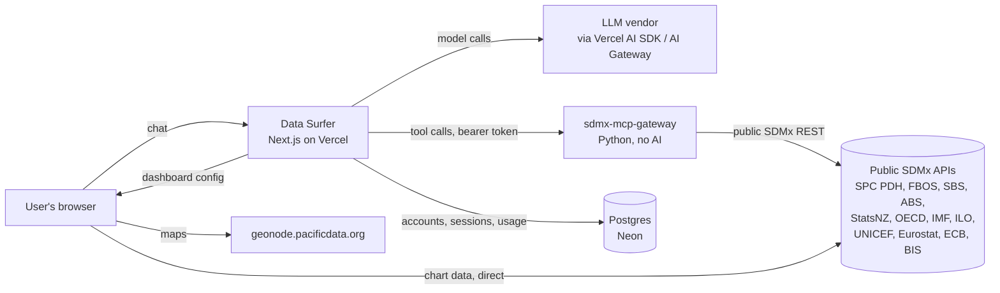

# Data Surfer: Architecture, Web Security and Responsible AI

*A briefing for the SPC IT team. November 2026.*

## 1. Purpose of this document

Data Surfer is moving from an invite-only alpha towards a service hosted under `pacificdata.org`. This document explains, for SPC IT, how the service is built, what it stores, how it uses AI, and where we would value your review.

We have aimed to be precise rather than promotional. Each claim points to the file that implements it, so you can verify it. Section 9 lists the limitations we know about and how we plan to address them.

**In one paragraph:** Data Surfer lets someone describe the dashboard they want ("child mortality in Melanesia since 2000, with a map"). It then builds that dashboard from official SDMx statistics. The work is split three ways:
- **Data discovery** is done by a deterministic, AI-free MCP gateway written in Python.
- **Drawing** is done by SPC's own open-source chart library.
- **A language model** sits between the two. It turns the request into a sequence of discovery calls, then into a dashboard specification.

The model does not supply the numbers in a chart. Every plotted value is fetched by the viewer's browser directly from the statistical agency's public API.

## 2. Architecture

| Component | What it is | AI? | Where it runs |
|---|---|---|---|
| Data Surfer app | Next.js 16 / React 19 / TypeScript, App Router | Orchestrates one LLM | Vercel (serverless functions) |
| [sdmx-mcp-gateway](https://github.com/Baffelan/sdmx-mcp-gateway) | Python MCP server, MIT licence (declared in `pyproject.toml`). Its only runtime dependencies are `mcp`, `pydantic`, `httpx` and `certifi`: no model, no AI library | **No** | Railway, behind a bearer token. Anyone can run their own copy from the public repository |
| [sdmx-dashboard-components](https://github.com/PacificCommunity/sdmx-dashboard-components) `1.0.0-rc.2` | SPC's React/ECharts SDMx dashboard library, published on npm, CC-BY-4.0 | **No** | The viewer's browser |
| [sdmx-json-parser](https://github.com/PacificCommunity/sdmx-json-parser) `0.4.2` | SPC's SDMX-JSON parser, on npm, ISC licence | **No** | The viewer's browser |
| Language model | One of several vendors (§4.4) | Yes | Vendor cloud |
| Database | Postgres on Neon, accessed with Drizzle ORM | No | Neon |
| Email | Resend (sign-in links and codes) | No | Resend |

The application code belongs to SPC. It is licensed under PolyForm Noncommercial 1.0.0, with documentation under CC BY-NC 4.0 (`LICENSE`, `LICENSE-DOCS`).

### 2.1 Deployment

| Piece | Hosted on | Details |
|---|---|---|
| Source code | GitHub, [`PacificCommunity/sdmx-surfer`](https://github.com/PacificCommunity/sdmx-surfer) (SPC's organisation) | `main` is production. A CI workflow runs lint, tests and the build on every pull request and every push to `main`. A daily Action rebuilds the dataflow catalogue and coverage index from the public SDMx APIs and commits them. The gateway URL and token and the embedding key are held as GitHub secrets |
| Web app and API | Vercel, paid plan (required for 300-second agent turns and for zero-data-retention routing) | **Production:** `sdmxsurfer.net`, built from `main`. **Development:** `sdmx-surfer.vercel.app`, built from the `dev` branch against its own database branch, with a banner pointing to production. TLS, scaling, the daily retention job, bot protection and the AI Gateway account sit in the same Vercel team. Secrets are Vercel environment variables. Server functions run in Sydney (`syd1`); static pages and routing are served from the edge nearest the visitor |
| MCP gateway | Railway, Singapore (`asia-southeast1`). Docker image of the public [`Baffelan/sdmx-mcp-gateway`](https://github.com/Baffelan/sdmx-mcp-gateway) repository | One HTTPS endpoint (`/mcp`), reachable only with the bearer token the app holds (`MCP_AUTH_TOKEN`). Stateless: it calls the public SDMx APIs and keeps nothing |
| Database | Neon (serverless Postgres), AWS `ap-southeast-2` (Sydney) | Separate branches for production and development. Neon provides encryption at rest and backups. Accessed only from the app's server functions and from maintainer scripts |
| Email | Resend | Sign-in links from `surfer@sdmxsurfer.net`. A receiving domain (`in.sdmxsurfer.net`) supports an email-proof sign-up, built but switched off |
| DNS | Hover (registrar for `sdmxsurfer.net`) | Interim domain until `surfer.pacificdata.org` (§8) |
| Map layers | SPC's `geonode.pacificdata.org` | Fetched directly by viewers' browsers |
| Language models | OpenAI, Anthropic and Google, through Vercel AI Gateway | §4.4–4.5 |

**Region.** The servers that run the application and store its data are in the Asia-Pacific:
- the app's server functions run in Sydney;
- the database is in Sydney;
- the MCP gateway is in Singapore;
- the Pacific Data Hub API answers through a Sydney edge.

Two things leave the region:
- model calls, which go to the AI vendors (mostly in the US) under the zero-data-retention terms in §4.5;
- sign-in emails, which are sent through Resend.

## 3. The data: public, open access, fetched as anyone would fetch it

Data Surfer has **no privileged access to any dataset**. It reads only the public SDMx REST APIs that statistical agencies publish for everyone. A researcher outside SPC can make exactly the same requests with `curl`. The list of providers is fixed in code (`lib/endpoints-registry.ts`):

| Key | Provider | API host |
|---|---|---|
| SPC | Pacific Data Hub | `stats-sdmx-disseminate.pacificdata.org` |
| FBOS | Fiji Bureau of Statistics | `data-sdmx-disseminate.statsfiji.gov.fj` |
| SBS | Samoa Bureau of Statistics | `data-sdmx-disseminate.sbs.gov.ws` |
| ABS | Australian Bureau of Statistics | `data.api.abs.gov.au` |
| STATSNZ | Stats NZ, Aotearoa Data Explorer | `api.data.stats.govt.nz` |
| OECD, ESTAT, IMF, ILO, UNICEF, ECB, BIS | International agencies | Their public SDMx endpoints |

Further details:
- **Stats NZ** publishes open data but asks every consumer to register for a free subscription key. We hold one server-side (`SDMX_STATSNZ_KEY`). A small relay, `app/api/sdmx-proxy/route.ts`, attaches it so the key never reaches the browser. The same relay passes through Eurostat and OECD, whose APIs do not send CORS headers. It accepts only those three hosts, each with a path allowlist, and only over https. Its abuse limits are described in §5.3.
- **Map layers** come from SPC's own `geonode.pacificdata.org` (Pacific EEZ boundaries).
- **Country Snapshots** is a sibling feature with curated country profiles. Its indicator list comes from SPC's 2026 indicator workbook, and every chart points at public Pacific Data Hub SDMx queries.
- **Catalogue index.** A pre-built index of dataflow titles, structures and availability (`models/dataflow-index.json`) is refreshed daily by a GitHub Action. It covers the 127 Pacific Data Hub dataflows. It is built from the same public catalogue endpoints and holds metadata only, no observations.

A Content-Security-Policy on every response builds its `connect-src` from the same provider registry (`lib/content-security-policy.ts`). Even if a dashboard configuration were tampered with, a viewer's browser could not be told to fetch from, or send data to, anywhere other than these agencies and SPC's map servers. Images and fonts are limited separately, to the basemap tiles (Esri), Google Fonts and a colour-scheme host.

## 4. How AI is used, and how it is kept honest

### 4.1 Design principle: AI as a matchmaker between deterministic parts

AI is deliberately kept out of the parts where correctness matters most. Both ends of the pipeline are conventional, deterministic, testable software that SPC or the SDMx community already trusts:

1. **Finding data** goes through the MCP gateway. It is plain Python that calls the SDMx REST API and summarises structures, codelists and availability. It contains no model, is cheap to run, and anyone can run their own copy.
2. **Drawing data** goes through `sdmx-dashboard-components`. Given a configuration and an SDMx data URL, the library fetches the observations and draws the chart.

The language model's job is to **connect the two**. It:
- reads the user's request and asks the gateway the right questions;
- chooses dataflows, dimensions and chart types;
- writes a dashboard configuration.

That configuration contains *SDMx query URLs, chart types, titles and notes*. It does **not** contain the plotted numbers. When the dashboard renders, the viewer's browser fetches each series directly from the agency's API (§2 diagram).

The result: **the model has no channel for supplying the numbers that are plotted**. If it picks the wrong series, the chart shows the right numbers for the wrong series. The panel's provenance link (`components/dataflow-provenance.tsx`) and the SDMx query make that mistake visible and checkable. The one free-form block the model can write is `extraOptions` (chart styling). It accepts presentation-only keys, so it cannot add data points or reference lines (§4.3).

### 4.2 What the model can see, and what it cannot

- **The model sees public metadata and small samples.**
  - It sees dataflow lists, dimension codelists, time availability, and the result of `probe_data_url`.
  - `probe_data_url` checks that a query returns data. It returns the observation count and a handful of sample observations, all of them public.
- **The model has no other network access.**
  - It gets 8 of the gateway's 19 tools (`lib/mcp-tool-policy.ts`, `DEFAULT_MODEL_FACING_MCP_TOOLS`).
  - It also gets two app-side tools: `update_dashboard`, and `get_indicator_coverage`, which returns observation *counts* per country and year, never values.
  - Tools that accept a URL refuse anything that is not a registered provider.
  - There is no web browsing, no code execution and no database access.
- **The model never sees personal data beyond the conversation.** User emails, passwords, keys and other users' sessions are never placed in its context.

### 4.3 Guardrails

| Layer | What it does | Where |
|---|---|---|
| Tool allowlist | Only discovery and verification tools are exposed to the model | `lib/mcp-tool-policy.ts` |
| URL guard | Probes and suggestions accept only http(s) URLs on registered providers | `lib/mcp-tool-policy.ts` |
| Intent-level authoring | The model writes a constrained, zod-validated schema, which is compiled server-side into the library format | `lib/dashboard-authoring.ts`, `lib/dashboard-schema.ts` |
| Reference safety | Data references may only target registered providers and SPC map hosts. Markup is stripped from all text | `lib/dashboard-safety.ts` (`sanitizeDashboard`) |
| Presentation-only chart options | `extraOptions` accepts only styling: axis names, stacking, colours, line style. Anything that could carry figures is dropped: `data`, `dataset`, `markLine`/`markPoint`/`markArea`, `graphic`, formatters containing digits, images. The model is told what was removed. Applied when the model emits a dashboard, on save, and on every public read | `lib/extra-options.ts`, `lib/dashboard-safety.ts` |
| Panels carry the numbers | The system prompt tells the model not to write figures in prose (chat, titles, notes); it describes what the data shows in words. A request for a number is answered with a KPI or table panel, whose value comes straight from the provider. Where a figure in text is unavoidable, it must be quoted exactly from a tool result in the conversation, naming the dataflow and provider. The model must never answer from memory | `lib/system-prompt.ts` (`LET THE PANELS CARRY THE NUMBERS`, `NOTHING FROM MEMORY`) |
| Step limits | At most 25 tool steps per turn in the builder (12 or 25 in Country Snapshots), with a nudge at 20 | `app/api/chat/route.ts` |
| Usage caps | 20 agent turns per person per rolling 24 hours, 5 published dashboards, and a global AI budget cap (default USD 1,000) | `lib/usage-caps.ts` |
| Error hygiene | Provider and model errors are never shown verbatim to users | `app/api/chat/route.ts` |
| Disclosure | Each published dashboard states once, under its title, that its titles and notes were composed with an AI assistant and that every charted figure is fetched directly from the listed providers | `app/p/[id]/page.tsx` |

The prompt rules were developed from observed failures, and each change is tested on more than one model. For example, given a probe that had returned Fiji's population and asked for the figure, both default models built a KPI panel or re-checked the data rather than writing the number in prose.

### 4.4 Vendor independence

The agent loop is written against the **Vercel AI SDK**, an open-source abstraction over model providers. Switching vendor is a configuration change, not a code change. The app supports:

- **Platform models through Vercel AI Gateway**, a single router in front of OpenAI, Anthropic and Google models. This is the production configuration. The catalogue is in `lib/platform-models.ts`. The gateway reports the cost of each request, which feeds the budget cap.
- **A direct Anthropic path**, used only when the gateway is disabled.
- **Bring-your-own-key (BYOK)** for Anthropic, OpenAI, Google and Mistral, so partner organisations can use their own contracts and data-processing terms.

Model choice is a routing decision in `lib/model-router.ts`. Because the deterministic parts carry the factual load, the app degrades gracefully across models: a weaker model makes worse choices of dataflow and chart, but the values it plots still come from the agency.

**Embeddings.** Semantic search over the Pacific Data Hub catalogue uses Google's `gemini-embedding-001` (`lib/embeddings.ts`). Dataflow descriptions are embedded when the index is built. On the `/explore` page the user's search phrase is also embedded, so it is sent to Google.

### 4.5 What goes to an AI vendor

The model vendor receives:
- the user's chat messages;
- the system prompt;
- the tool results (public SDMx metadata and samples);
- the current dashboard configuration.

It does not receive account data.

**Retention by the vendor.** Every request through AI Gateway sets `zeroDataRetention` and `disallowPromptTraining` (`providerOptionsFor` in `lib/model-router.ts`):
- **Routing:** with zero data retention (ZDR) set, the gateway only routes to providers with a ZDR agreement. The gateway itself does not keep prompts or responses.
- **Coverage:** all five platform models are served under ZDR, verified with live requests: OpenAI for GPT, Anthropic for Claude, and Google Vertex for Gemini. Google AI Studio, which lacks ZDR, is skipped.
- **Fallback:** a per-model flag in `lib/platform-models.ts` lets a future model without a ZDR provider fall back to no-training only, rather than becoming unavailable. The data involved is open statistics, so availability was preferred over dropping the model.
- **Own keys:** BYOK requests and the direct Anthropic path run under the key holder's own API terms.

## 5. Web security

### 5.1 Authentication

Authentication is built on **Auth.js v5**:
- `lib/auth.ts` holds the server side. `lib/auth.config.ts` and `proxy.ts` hold the edge-safe side, which gates every page.
- Sessions are signed JWT cookies that expire after 7 days without use.
- Every 5 minutes the server re-checks the user against the database. A removed or no-longer-admitted user is signed out, and a role change takes effect (`lib/session-revalidation.ts`).

| Mechanism | Details |
|---|---|
| Admission | Invite-only. An email must match an admin bootstrap list, an allowed domain, or an allowed address (`lib/admission.ts`, `lib/signup-policy.ts`). The domain list holds partner organisations, e.g. `spc.int`, `mfat.govt.nz` and the suffix rule `.govt.nz`. Consumer email domains are refused for domain rules. Two wider modes exist behind environment flags and are off unless configured: open sign-up for named OAuth providers, and password sign-up for listed domains |
| OAuth | Google, Microsoft Entra and GitHub, each enabled only when configured. GitHub requires a verified email; Entra checks the email-verified claim |
| Passwords | **Argon2id** (m = 19 MiB, t = 2, p = 1), 12–128 characters (`lib/password.ts`) |
| Brute force | An account locks for 15 minutes after 5 failures. A per-email throttle allows 10 failures per 10 minutes, unknown emails included (`lib/auth-throttle.ts`) |
| Magic links | 15-minute validity, single use. In production, a link is never written to logs: if the email service is not configured, sending fails |
| Email proof | One-time code: 50-bit code, browser secret stored only as SHA-256, 15-minute TTL, 5 starts per hour per address and per IP |
| Bot protection | Vercel BotID on the sign-up and email-proof endpoints (`instrumentation-client.ts`) |
| Workshop codes | Failed claims of a shared workshop code are throttled: 30 per IP and 200 overall per 15 minutes, recorded as auth events |

### 5.2 Authorisation and data boundaries

- Every private API route checks the session server-side and scopes database queries to the owner's `userId`. A request for another user's session returns 404, so session identifiers cannot be probed.
- Administrative routes (`app/api/admin/**`) require `role = "admin"`.
- **Public dashboards** (`/p/[id]`, `/gallery`) use a reduced projection: title, description, configuration, author display name and publication date. It never includes chat history, edit history, owner email or keys. Public reads re-sanitise on every request and are served with `Cache-Control: no-store` (`docs/current-architecture.md` §6).

### 5.3 Browser-side and network defences

- **Content-Security-Policy:** set on every response, with `connect-src` limited to this site, the registered SDMx providers and SPC map hosts. `frame-ancestors 'self'` applies everywhere except published dashboards, which SPC sites (`*.pacificdata.org`, `*.spc.int`) may embed.
- **Other headers** (`next.config.ts`):
  - `Strict-Transport-Security` (2 years);
  - `X-Frame-Options: SAMEORIGIN`, except on embeddable published dashboards;
  - `X-Content-Type-Options: nosniff`;
  - `Referrer-Policy: strict-origin-when-cross-origin`;
  - a `Permissions-Policy` disabling camera, microphone, geolocation, payment, USB and topics.
- **Markup stripping:** applied to every text field of a dashboard, on save, publish and public read. The chart library renders some strings as HTML, so this closes a stored-XSS path.
- **CSRF:**
  - Every POST, PUT, PATCH and DELETE route checks the `Origin` header against the deployment URL.
  - Credential, sign-up, account and admin routes use a strict mode that rejects a missing `Origin` (`lib/csrf.ts`).
  - No GET request creates data. Two GET endpoints have narrow side effects: opening a magic link marks it as used, and listing your own sessions removes your own empty, untitled drafts.
- **SDMx relay limits** (`lib/rate-limit.ts`):
  - Requests that use the Stats NZ key are limited to 120 per IP in any 10-minute span.
  - A sliding-window counter prevents bursts at window boundaries. A single atomic SQL statement decides each request, so the limit holds across serverless instances.
  - IPs are stored only as a keyed hash (HMAC-SHA256 with a server secret).
  - Every relayed response is capped at 20 MB.
  - On Vercel, `X-Forwarded-For` is set by the platform and cannot be spoofed by clients, so per-IP limits are reliable.
- **No secrets in the client bundle:** there are no `NEXT_PUBLIC_*` secrets. All keys are read server-side from Vercel environment variables.

### 5.4 Dependencies

`SECURITY_AUDIT.md` records the dependency audit history and the reasoning for each remaining item. As of 17 November 2026:
- **`npm audit --omit=dev` reports no advisories for production dependencies.**
- Six moderate advisories remain, all in maintenance tooling that never runs in production: drizzle-kit's bundled esbuild, and the spreadsheet reader used by an import script.
- A high or critical advisory in a production dependency blocks a release.

We would welcome SPC's standard dependency scanning on the repository.

## 6. What we store, and who can see it

The data model is small and every table is documented (`lib/db/schema.ts`). A daily job enforces the retention periods below (`lib/retention.ts`, scheduled in `vercel.json`, authenticated with `CRON_SECRET`). The About page explains the same in plain language, in a "What we record" section linked from the sign-in page.

The policy has two parts:
- **Usage records** (counts, tokens, cost) are kept for budget accounting and are never deleted within 12 months.
- **Logs and prompt excerpts** are kept for **3 months**, which gives administrators time to review misuse, and are then removed.

**Account deletion is self-service** (Settings → Delete account, confirmed by typing the account's email; `lib/account-deletion.ts`):
- **Removed at once:**
  - the user's dashboards, which are unpublished immediately and erased for good after 30 days;
  - their API keys and OAuth links;
  - any pending sign-in tokens;
  - their password, name and picture.
- **Signed out:** the browser that deleted the account immediately, and any other session within 5 minutes.
- **Email address:** released immediately, so the person can register again.
- **Kept for review:** the original address stays visible to administrators, next to the account's usage, for 3 months, and is then erased. The anonymous usage counts remain for the budget.

Deletion cannot be used to hide misuse, because the record of past use outlives the account by the same 3 months that applies to everyone.

**Costs are never deleted.** Usage rows, with their token counts and cost, stay attached to the deleted account's anonymous record. Spending by people who create and delete accounts therefore stays in the global AI budget and in admin spend reports. Bulk removal of workshop accounts (`scripts/training-accounts.ts --delete`) uses the same deletion path.

Deleting and re-registering does not reset the per-person daily limit either. During the 3-month review window, the limit also counts the usage of earlier accounts deleted under the same address (`usageOfPerson` in `lib/usage-caps.ts`).

| Data | Why | Protection | Kept | Who can read it in the app |
|---|---|---|---|---|
| Email, display name, avatar URL | Account identity | Database encryption at rest (Neon) | While the account exists. On deletion, name and picture are cleared at once and the email is kept 3 months for misuse review | The user; admins |
| Password hash | Password sign-in | **Argon2id**; never stored or logged in plain text | While the account exists | Nobody |
| BYOK API keys (optional) | The user's own model contract | **AES-256-GCM**, random 96-bit IV, 128-bit auth tag. The key is derived from a rotatable server secret (`scripts/rotate-encryption-secret.ts`). Never returned to the browser | Until the user removes it | Nobody; decrypted only in memory for the user's own requests |
| OAuth account tokens | Standard Auth.js account linking | Database encryption at rest | While the account exists | Nobody via the app |
| Dashboard sessions | The user's dashboards and their chat transcripts | Owner-scoped queries | Until the user deletes them; deleted ones are purged after **30 days** | The owner; public projection only if published |
| Usage logs | Cost control, abuse detection, quality review | Truncated excerpts: prompt ≤ 500 chars, reply ≤ 1,000, tool arguments ≤ 500, results ≤ 300 | Excerpts removed after **3 months**. Token counts and cost kept for budget accounting, never deleted within 12 months | **Admins only** |
| Auth events | Security audit trail: sign-ins, failures, password changes, account deletions | Includes email and IP for failed attempts | **3 months** (90 days) | Admins only |
| Rate-limit counters | Relay abuse protection | Keyed HMAC of the IP; no raw IP | About 20 minutes | Nobody |

**Logs:**
- Every route that reads `usage_logs` requires the admin role.
- No route exposes one user's logs, chats or private dashboards to another user.
- The app has **no third-party analytics or trackers**: no Google Analytics, Sentry, PostHog or Vercel Analytics.
- The only cookies are the Auth.js session cookies and one short-lived, httpOnly, path-scoped cookie for email proof.

**Secrets:**
- All service secrets live in Vercel's encrypted environment variables: `AUTH_SECRET`, `ENCRYPTION_SECRET`, `CRON_SECRET`, the model API keys, `MCP_AUTH_TOKEN`, `SDMX_STATSNZ_KEY` and the database URL.
- `.env*.local` files are gitignored, and no secret is committed to the repository.

## 7. Testing and quality

**Automated tests.** 577 Vitest tests in 45 files. A GitHub Actions workflow (`.github/workflows/ci.yml`) runs lint, the tests and the production build on every pull request and every push to `main`. The tests concentrate on logic where mistakes are costly:
- admission and sign-up policy, login redirects, email proof, CSRF and IP helpers;
- encryption round-trips, tamper detection and key rotation;
- model routing, BYOK fallback and zero-data-retention options;
- the MCP tool policy and URL guard;
- dashboard safety: host allowlist, markup stripping and presentation-only chart options;
- security headers and framing rules, session revalidation, the workshop-code and relay rate limits, the retention job and account deletion;
- usage caps and budget accounting;
- dashboard authoring and compilation, message sanitisation, and the Country Snapshots catalogue, import pipeline and fork route.

A module-boundary test keeps the Country Snapshots feature isolated from the core app.

**Release process.**
1. Every change goes first to the development deployment, which has its own URL and an isolated database branch.
2. The change is checked there.
3. The production database is backed up before any schema migration.
4. Production is updated by fast-forwarding `main`.

The procedure is documented in `docs/technical-reference.md` §19.

**Library and gateway acceptance:**
- Before adopting the npm release of `sdmx-dashboard-components` 1.0, we rendered 11 reference dashboards (99 panels) across 11 providers and compared them with the previous build (`docs/sdmx-dashboard-components-1.0-integration.md`).
- The MCP gateway has its own live end-to-end suite: 41 scenarios across 10 providers (`docs/mcp-endpoint-per-call-update.md`).
- Fixes needed in SPC's chart library are written up and contributed as upstream pull requests (`docs/upstream-prs/`, `docs/sdmx-dashboard-components-improvements.md`), not kept as private patches.

**User testing:**
- The invite-only alpha has run with roughly **50 users** across Pacific governments and partner organisations (`docs/prototype-to-production.md`).
- A **workshop mode** gives around **100 participants** their own accounts in minutes. It uses a shared code and a pool of 200 temporary accounts, which are parked or deleted afterwards (`docs/training-day.md`).
- Observed sessions drove much of the product's design. Examples: the provenance and pacing rules in the system prompt, empty-data recovery through `suggest_nonempty_queries`, multi-angle dashboards instead of single charts, and Pacific-centred maps (EPSG:3832).
- The usage logs in §6 serve this purpose too: they show where the agent struggles, so the prompt and tools can be improved.

**Model evaluation.** Prompt changes are checked against the case that motivated them and re-run on more than one model.

## 8. Pending with SPC

| Item | Status |
|---|---|
| Registration in SPC authentication (Microsoft Entra / SSO) | **Waiting on SPC IT.** The provider is implemented and needs an app registration in SPC's tenant (`docs/oauth-setup.md`). Microsoft sign-in stays disabled until then |
| Google sign-in for production | Needs an SPC-owned Google Cloud project in Published status. Testing status caps at 100 users |
| Email delivery to `spc.int` | **Needs an IT message trace.** SPC's Exchange Online accepts sign-in emails from our sender (Resend reports them "delivered"), but they never reach the mailbox, junk folder or quarantine. A hybrid hand-off to on-premises Exchange, or a transport rule, is the likely cause (`docs/superpowers/plans/2026-11-06-sign-in-and-demo-access.md`). SSO would make this moot for SPC staff |
| Move to `surfer.pacificdata.org` | **Waiting on DNS and registration.** The app currently runs at `sdmxsurfer.net`. The move needs the OAuth redirect URIs re-registered for all three providers. Moving the email sender to the SPC domain would also help deliverability |
| Hosting jurisdiction | The app's functions and database run in Sydney and the stateless MCP gateway in Singapore. Model calls go to the AI vendors, and sign-in emails go through Resend. None of this is in a Pacific Island country. We would like SPC's guidance on whether this is acceptable for this class of data: public statistics, plus user emails and chat text |
| Named owner and on-call | A governance decision for the public beta (`docs/prototype-to-production.md` §7) |

## 9. Known limitations and planned work

None of the items below involves non-public statistical data, because the service holds none.

1. **Admins can read prompt excerpts** for 3 months. This is intended, for quality review and abuse handling, and is disclosed on the About page. A separate, smaller "reviewer" role could narrow access further.
2. **Admin-set passwords** are a stopgap that gives access before a proper sign-in integration exists. They will be removed once SPC SSO is in place.
3. **`'unsafe-inline'` scripts in the CSP.** Next.js needs it for its bootstrap scripts, and markup stripping is the XSS defence. A nonce-based CSP is possible but makes every page dynamic; we will revisit it as the framework evolves.
4. **OAuth email account linking** (`allowDangerousEmailAccountLinking`) lets one person sign in through different providers with the same email. GitHub and Entra are checked for a verified email. This will be reviewed as part of item 6.
5. **Numbers in prose.** The model cannot supply plotted values, and the prompt steers figures into panels (§4.3). Text the model writes is not checked by code.
6. **The authentication library.** `next-auth` v5 has been in beta since 2023. The Auth.js project became part of Better Auth in 2025, and Better Auth joined Vercel in 2026. Integrating SPC's sign-in (Entra SSO) is the natural moment to move to Better Auth rather than carry a beta into production. This is the largest planned piece of work. It also retires items 2 and 4, and we would like to plan it with SPC IT.

## 10. Where to look in the code

| Topic | Files |
|---|---|
| Agent loop | `app/api/chat/route.ts`, `lib/system-prompt.ts` |
| Model routing and BYOK | `lib/model-router.ts`, `lib/platform-models.ts`, `lib/encryption.ts`, `app/api/settings/keys/route.ts` |
| MCP access and tool policy | `lib/mcp-client.ts`, `lib/mcp-tool-policy.ts` |
| Dashboard schema and safety | `lib/dashboard-authoring.ts`, `lib/dashboard-schema.ts`, `lib/dashboard-safety.ts`, `lib/extra-options.ts` |
| Data providers, relay, CSP and headers | `lib/endpoints-registry.ts`, `lib/proxied-hosts.ts`, `app/api/sdmx-proxy/route.ts`, `lib/rate-limit.ts`, `lib/content-security-policy.ts`, `next.config.ts` |
| Authentication and sessions | `lib/auth.ts`, `lib/auth.config.ts`, `proxy.ts`, `lib/session-revalidation.ts`, `lib/admission.ts`, `lib/signup-policy.ts`, `lib/password.ts`, `lib/auth-throttle.ts`, `lib/csrf.ts` |
| Storage, retention and deletion | `lib/db/schema.ts`, `drizzle/`, `lib/logger.ts`, `lib/usage-caps.ts`, `lib/retention.ts`, `lib/account-deletion.ts` |
| Deployment | `vercel.json`, `.github/workflows/`, `docs/technical-reference.md` §19 |
| Architecture reference | `docs/current-architecture.md`, `docs/technical-reference.md`, `docs/prototype-to-production.md`, `SECURITY_AUDIT.md` |

We are happy to walk the team through any of this, provide read access to the repository and the development deployment, and take on the items in §9 in whatever order IT considers most important.
