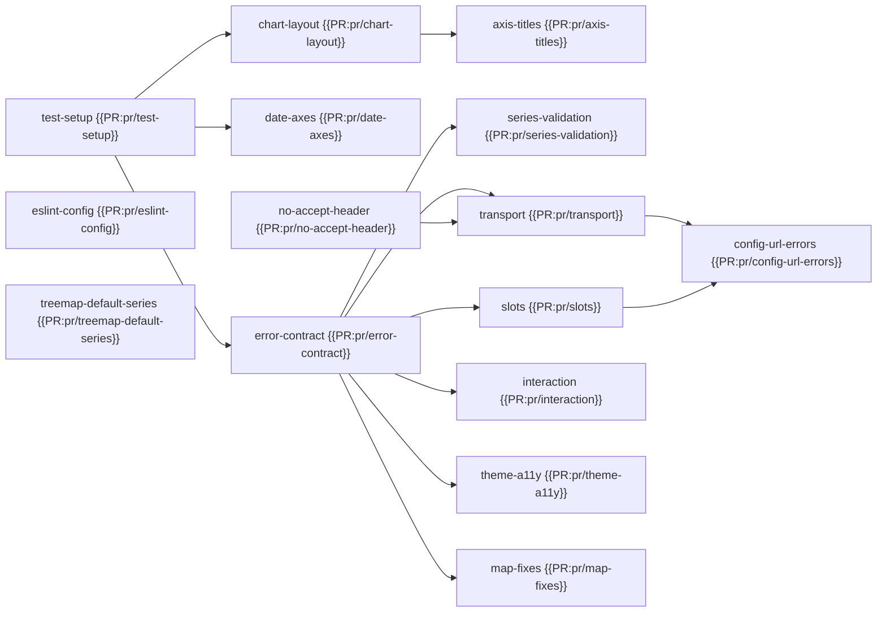

# Upstreaming the SDMX Surfer changes to 1.0: error contract, transport, theming and fixes (15 PRs)

## Context

SDMX Surfer is a dashboard builder in which an LLM agent writes the dashboard configs that this library renders. The agent reads the library's error codes and messages to correct its own configs, so Surfer needs a stable error contract and render-status callbacks. Before 1.0, these features lived in a Highcharts-era fork (`gvdr/sdmx-dashboard-components`, branches `pr1-observability` → `pr2-rendering-transport` → `pr3-api-theming-a11y`, on 0.4.6). They have been ported onto the ECharts-based `v1.0.0-rc.1`, together with fixes found while moving Surfer onto rc.1.

As requested, the work is split into 15 small PRs that you can accept or reject one by one. Every PR is a branch `pr/<name>` on `gvdr/sdmx-dashboard-components`, opened against `main`. A stacked PR's diff against `main` includes its dependencies. Each PR body therefore links the incremental diff against its base and lists the commits to review. Every commit message records the commit it was cherry-picked from and any adaptation made for a branch without its siblings. Each PR also works with `/ai-review`.

## Dependency graph



## PRs

"Own diff" is the size of the PR's own commits (excluding `package-lock.json`, tests included). "Tests" is the `npm test` result measured on the branch (rc.1: 8 tests).

| PR | Title | Depends on | Own diff | Tests | Risk / notes |
|---|---|---|---|---|---|
| {{PR:pr/test-setup}} | test: jsdom setup for component tests | – | 1 commit, 4 files, +39/−1 | 10 | devDependencies only |
| {{PR:pr/eslint-config}} | lint: add an ESLint config so npm run lint runs | – | 1 commit, 14 files, +54/−12 | 8 | no behaviour change; lint-only hunks in files that many later PRs touch |
| {{PR:pr/no-accept-header}} | data: stop sending the SDMX-JSON 2.0 Accept header | – | 1 commit, 6 files, +78/−24 | 11 | changes request headers. ECB/IMF/BIS need parser 0.4.1 ({{PARSER_PR}}) |
| {{PR:pr/treemap-default-series}} | treemap: default the series dimension without legend.concept | – | 1 commit, 2 files, +76/−3 | 10 | small fix; needs a 3-file follow-up once {{PR:pr/error-contract}} is also in (see below) |
| {{PR:pr/date-axes}} | chart: dates on business-day and weekly time axes | test-setup | 2 commits, 5 files, +347/−30 | 60 | time-axis labels change for B, W, S, T and unknown frequencies |
| {{PR:pr/chart-layout}} | chart: top legend below the title, drop grid.containLabel | test-setup | 1 commit, 4 files, +195/−9 | 15 | layout only; same placement as rc.1 without the ECharts deprecation log |
| {{PR:pr/axis-titles}} | chart: axis titles, download flag, typed dashboard rows | chart-layout | 2 commits, 11 files, +362/−85 | 27 | additive; fixes the `colums` type |
| {{PR:pr/error-contract}} | errors: typed render errors and render status callbacks | test-setup | 3 commits, 22 files, +1247/−231 | 48 | the largest and most central PR; changes how every failure is shown |
| {{PR:pr/series-validation}} | chart: descriptive errors for ambiguous series structure | error-contract | 1 commit, 4 files, +300/−0 | 63 | ambiguous charts that used to render now fail with an explanation |
| {{PR:pr/transport}} | data: injectable fetcher with dedup, cache, retry and telemetry | error-contract, no-accept-header | 3 commits (+ merge), 19 files, +878/−53 | 75 | most delicate logic (cache, effect keys). Data requests go through `fetcher` only with parser 0.4.1 |
| {{PR:pr/slots}} | ui: renderLoading, renderEmpty and renderError slots | error-contract | 1 commit, 9 files, +208/−10 | 56 | additive |
| {{PR:pr/config-url-errors}} | dashboard: report a config URL that fails to load | transport, slots | 1 commit (+ merge), 3 files, +167/−28 | 88 | small |
| {{PR:pr/interaction}} | chart: onUserInteraction callback | error-contract | 1 commit, 10 files, +423/−10 | 62 | additive; charts only |
| {{PR:pr/theme-a11y}} | theme: SDMXTheme and a hidden data table under each chart | error-contract | 1 commit, 21 files, +424/−53 | 60 | touches the most shared files; adds a hidden table to the DOM |
| {{PR:pr/map-fixes}} | map: colour scale, zero values, join, basemap and export | error-contract | 1 commit, 8 files, +416/−72 | 64 | visible map changes (scale, zeros, CORS tiles) |

**Independent leaves you can take first, in any order:** {{PR:pr/test-setup}}, {{PR:pr/eslint-config}}, {{PR:pr/no-accept-header}} and {{PR:pr/treemap-default-series}}. After {{PR:pr/test-setup}}, the chart PRs {{PR:pr/date-axes}} and {{PR:pr/chart-layout}} (then {{PR:pr/axis-titles}}) do not need the error contract.

## Suggested merge order

This is the order in which `surfer-integration` merges the branches, so every conflict along it has a tested resolution there:

1. {{PR:pr/eslint-config}}, {{PR:pr/test-setup}}, {{PR:pr/no-accept-header}}
2. {{PR:pr/date-axes}}, {{PR:pr/chart-layout}}, {{PR:pr/axis-titles}}, {{PR:pr/treemap-default-series}}
3. {{PR:pr/error-contract}}, then the treemap follow-up (below)
4. {{PR:pr/series-validation}}, {{PR:pr/transport}}, {{PR:pr/slots}}, {{PR:pr/config-url-errors}}
5. {{PR:pr/interaction}}, {{PR:pr/theme-a11y}}, {{PR:pr/map-fixes}}

**Conflicts.** Sibling PRs that are not stacked on each other still edit the same files, mostly `chart/index.tsx`, `types.ts`, `lib/index.ts`, the component signatures and the README. Each PR body lists the siblings it conflicts with. After each merge I will rebase the remaining branches onto the new `main`, reusing the resolutions from `surfer-integration`. If you merge with a merge commit, the dependent PRs shrink to their own commits by themselves. With squash or rebase merges they need that rebase first.

**Rejecting a PR.**

- Rejecting {{PR:pr/eslint-config}}, {{PR:pr/treemap-default-series}}, or any PR with nothing stacked on it, affects nothing else.
- {{PR:pr/test-setup}} is only test tooling, but the component tests of most later PRs need it.
- Rejecting {{PR:pr/error-contract}} blocks the seven PRs built on it.
- Rejecting {{PR:pr/no-accept-header}} means {{PR:pr/transport}} needs to be rebuilt without that merge.

## Stays fork-only for now

- **Treemap follow-up, 7eb30c2 on `surfer-integration`.** {{PR:pr/treemap-default-series}} throws a plain `Error` so that it stands on `main` alone. Once {{PR:pr/error-contract}} is also merged, the follow-up:
  - turns it into `SDMXRenderError('ERR_NO_SERIES_DIMENSION')` with `detail`;
  - restores the two contract-level tests;
  - moves `treemap.test.ts` to the new `loadDatasets(config, language)` signature.

  The follow-up is required, not cosmetic. I merged the two branches without it, and both treemap tests fail with `TypeError: Cannot read properties of undefined (reading 'forEach')`. I will open it as soon as the second of the two is merged, or add it to that PR if you prefer.
- **Version bump.** Not proposed: release on your own schedule. The peer range stays `sdmx-json-parser ^0.4.0`. Raising it to `^0.4.1` once the parser is published would make the parser-dependent features explicit.

## Try everything at once

The fork branch `surfer-integration` (7eb30c2) contains all 15 branches merged in the order above, plus the treemap follow-up. Its library code equals the build SDMX Surfer runs on; the only differences are test files and `package.json` keeping `1.0.0-rc.1`. Measured on it: `npm test` 28 files, **216 passed**; `npm run lint` exit 0; `npm run build` exit 0.

```sh
git fetch https://github.com/gvdr/sdmx-dashboard-components surfer-integration
git checkout FETCH_HEAD && npm ci && npm test && npm run lint && npm run build
# parser 0.4.1 (prepare builds dist/ on a git install):
npm install github:gvdr/sdmx-json-parser#dialects-0.4
```

Downstream acceptance (Surfer's integration notes on this library code with parser 0.4.1):

- **Providers.** A panel from each of 11 providers renders: SPC, FBOS, SBS, ECB, OECD, ILO, ABS, UNICEF, BIS, IMF, and StatsNZ through Surfer's proxy.
- **Saved dashboards.** All 99 panels of the 11 published dashboards match the pre-migration baseline. The 9 panels that fail do so on both builds (7 `ERR_NO_SERIES_DIMENSION`, 2 IMF `ERR_EMPTY`).

## Companion parser PR

{{PARSER_PR}} on `PacificCommunity/sdmx-json-parser` covers four things: request negotiation, root-dialect normalisation (ECB, IMF), numeric-string values (BIS, UNICEF, IMF), and the `fetcher` and `NO_RECORDS` features used here. Without it:

- the data requests of {{PR:pr/transport}} bypass `fetcher`;
- {{PR:pr/error-contract}} never sees `NO_RECORDS`;
- ECB and IMF stay unreadable. With rc.1's header they answer 406/500, and without it parser 0.4.0 does not read their root-level dialect (`getStructure()` throws "Structure not found").
